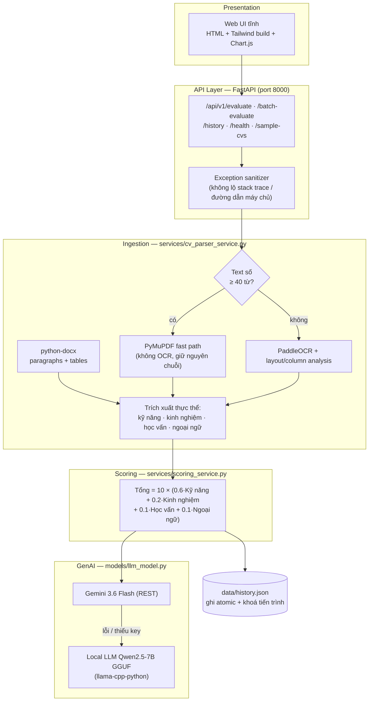

<div align="center">

# TalentMatch Enterprise | Hệ thống Thẩm định Hồ sơ & Chuẩn hóa Tuyển dụng

[](https://www.python.org/)
[](https://fastapi.tiangolo.com/)
[](https://www.docker.com/)
[](https://github.com/PaddlePaddle/PaddleOCR)
[](https://pytest.org/)

Trích xuất hồ sơ từ PDF digital, PDF scan và DOCX → chấm điểm theo 4 tiêu chí có trọng số → sinh báo cáo phân tích bằng LLM, chạy hoàn toàn trên máy cục bộ.

</div>

---

## 1. Bài toán và phạm vi

Tự động hoá bước sàng lọc đầu tiên của quy trình tuyển dụng kỹ thuật: từ một Job Description và một file CV, hệ thống trả về

- điểm tổng hợp thang **10** cùng breakdown từng tiêu chí,
- báo cáo Markdown giải thích *tại sao* đạt / không đạt và khoảng trống kỹ năng,
- bộ câu hỏi phỏng vấn kỹ thuật cá nhân hoá theo lỗ hổng phát hiện được,
- nhật ký đánh giá để tra lại về sau.

Hệ thống phục vụ mục đích học tập và portfolio; **không** phải công cụ tuân thủ (compliance) cho HR production.

---

## 2. Kiến trúc



---

## 3. Chấm điểm: công thức và ngữ nghĩa

`services/scoring_service.py` trả về `(total_score, breakdown)`; `total_score` là điểm **đa tiêu chí**, không phải riêng kỹ năng.

| Tiêu chí | Trọng số | Cách tính tỷ số |
| :--- | :--- | :--- |
| Kỹ năng chuyên môn | **60%** | `tech_score_10 / 10` — khớp kỹ năng JD theo cấp độ (Basic/Intermediate/Good/Senior) với alias (`k8s`→Kubernetes, `postgres`→PostgreSQL) |
| Kinh nghiệm thực tế | **20%** | `min(năm_ứng_viên / năm_yêu_cầu, 1)`; JD không yêu cầu = điểm tối đa |
| Trình độ học vấn | **10%** | Đạt = 1.0 · tìm thấy bằng cấp thấp hơn = 0.5 · không tìm thấy = 0.0 |
| Ngoại ngữ | **10%** | `số_ngôn_ngữ_khớp_trình_độ / số_ngôn_ngữ_yêu_cầu` — có thể bỏ trống nếu JD không yêu cầu |

Mỗi tiêu chí gắn nhãn `Đạt` / `Chưa đạt`; kết luận tổng hợp:

- `Đạt Yêu Cầu` — cả 4 tiêu chí đạt.
- `Cân Nhắc Phỏng Vấn` — kỹ năng đạt và nhiều nhất 1 tiêu chí phụ chưa đạt.
- `Chưa Đạt Yêu Cầu` — các trường hợp còn lại.

`breakdown` kèm khoá `Total_Score` và `Weights` để UI hiển thị đúng công thức đã dùng (không hard-code trong frontend).

### Ngoại ngữ là tuỳ chọn, và có so trình độ

JD không phải lúc nào cũng yêu cầu ngoại ngữ, nên tiêu chí này bật/tắt được trên UI (radio *Không yêu cầu* / *Có yêu cầu*), và khi bật có thể thêm nhiều dòng — mỗi dòng một ngôn ngữ kèm mức tối thiểu.

Định dạng gửi lên API: `foreign_languages=English:advanced,Japanese:basic`. Chuỗi rỗng nghĩa là không yêu cầu → ứng viên không bị trừ 10% trọng số này.

Cả hai bên đều quy về cùng một thang 4 bậc (`LANGUAGE_LEVELS` trong `core/constants.py`) nên so sánh được bằng số:

| Bậc | CEFR | Ví dụ bằng chứng từ CV được tự động quy đổi |
| :--- | :--- | :--- |
| `basic` (1) | A1–A2 | tên ngôn ngữ đứng một mình, `Cơ bản`, `HSK 1-2`, `JLPT N3-N5` |
| `intermediate` (2) | B1–B2 | `IELTS 5.0–6.5`, `TOEIC 600–780`, `TOEFL 60–93`, `JLPT N2`, `HSK 3-4` |
| `advanced` (3) | C1 | `IELTS 7.0–8.0`, `TOEIC 785–940`, `TOEFL 94–104`, `JLPT N1`, `HSK 5`, `Thành thạo`, `Fluent` |
| `native` (4) | C2 | `IELTS 8.5+`, `TOEIC 945+`, `TOEFL 105+`, `HSK 6`, `Bản ngữ`, `Native` |

Ứng viên đạt khi có **cùng ngôn ngữ** ở bậc **bằng hoặc cao hơn** yêu cầu. Chỉ ghi tên ngôn ngữ mà không có bằng chứng mức độ được tính là `basic` — đủ cho yêu cầu cơ bản, không đủ cho C1.

> **Cạm bẫy đã gặp:** FastAPI coi một field form gửi chuỗi rỗng == field bị bỏ trống và thay bằng giá trị `Form(...)` default. Vì vậy default của `foreign_languages` bắt buộc phải là `""`; để `"English:basic"` thì chọn "Không yêu cầu" trên UI vẫn âm thầm bị ép tiếng Anh. Có test khoá hành vi này lại.

### Vai trò của embedding

`intfloat/multilingual-e5-base` được nạp lazy và dùng làm **fallback ngữ nghĩa khi regex không xác định được trình độ học vấn** (cosine similarity giữa dòng văn bản và các bậc học). Khớp kỹ năng vẫn là thuật toán có trọng số cấp độ — trang này không tuyên bố semantic search cho toàn bộ pipeline.

---

## 4. Trích xuất tài liệu

| Đầu vào | Đường đi | Ghi chú |
| :--- | :--- | :--- |
| PDF có text layer | PyMuPDF, bỏ qua OCR | Văn bản số **không** đi qua bộ làm sạch OCR, vì nó phá chuỗi hợp lệ (`Django4` → `Djang04`) |
| PDF scan / ảnh | PaddleOCR PP-OCRv4 + phân tích cột bằng OpenCV | Tự kích hoạt khi text số < 40 từ |
| DOCX | `python-docx`: paragraphs **và tables** | Bảng CV (thông tin cá nhân, kỹ năng) không nằm trong `doc.paragraphs` |

Tính kinh nghiệm gộp các khoảng thời gian (`2021 - 2024`, `2022 đến nay`, `2019 to present`) rồi hợp nhất khoảng chồng lấn, đồng thời bỏ qua dòng chứa từ khoá học vấn để không đếm năm đi học thành năm đi làm.

---

## 5. LLM và chuỗi fallback

1. **Gemini 3.6 Flash** qua REST, API key đặt trong header `x-goog-api-key` (không nằm trong URL/log). Nếu model đầu lỗi, tự thử `gemini-3.5-flash-lite`.
   - Bộ model này được chọn bằng gọi thật với API key đang dùng: khoá tạo từ 2026 **không còn** truy cập được dòng `gemini-2.5-*` (Google trả 404 "no longer available to new users").
   - `maxOutputTokens` đặt 8192 vì token "suy nghĩ" của Gemini được tính vào giới hạn này; đặt hẹp khiến mô hình trả về `parts` rỗng và báo cáo biến mất.
2. Mọi lỗi provider được gói trong `LLMProviderError` (`GeminiNotConfiguredError`, `GeminiAPIError`, `LocalLLMError`).
3. `services/llm_service.py` bắt các exception đó và **fallback sang Local LLM đã nạp**; nếu local cũng không khả dụng, người dùng nhận một thông báo Markdown thân thiện kèm **một dòng nguyên nhân đã làm sạch** (không chuyển tiếp body thô của Google, không lộ key).
4. Mỗi mã HTTP được dịch sang tiếng Việt qua bảng `GEMINI_STATUS_HINTS` — ví dụ `PERMISSION_DENIED` → "khoá không hợp lệ hoặc chưa được bật cho project", `RESOURCE_EXHAUSTED` → "đã vượt hạn mức của free tier".

---

## 6. API

| Method | Đường dẫn | Mô tả |
| :--- | :--- | :--- |
| `POST` | `/api/v1/evaluate` | Thẩm định 1 CV (multipart: `file`, `job_title`, `tech_skills`, `foreign_languages`, …) |
| `POST` | `/api/v1/batch-evaluate` | Xếp hạng nhiều CV; trả `processed`, `saved_to_history`, `failed[{file_name, reason}]` |
| `GET` | `/api/v1/history` | Danh sách nhật ký đánh giá (mới nhất trước) |
| `DELETE` | `/api/v1/history` | Xoá nhật ký — cần `X-Admin-Token` nếu đã đặt `APP_ADMIN_TOKEN` |
| `GET` | `/api/v1/health` | Trạng thái **thật** của từng động cơ |
| `GET` | `/api/v1/sample-cvs` | CV mẫu trong `data/sample_cvs/` |
| `GET` | `/` · `/assets/*` | Web UI tĩnh và tài nguyên |
| `GET` | `/docs` | Swagger UI |

`/api/v1/health` trả trạng thái thật của từng động cơ: `operational` / `available_lazy` / `loaded` / `missing_api_key` / `missing_llama_cpp` / `missing_weights` / `available`, và báo `status: "degraded"` khi có động cơ thiếu thật. `llm_local` phân biệt rõ "chưa cài `llama-cpp-python`" với "có thư viện nhưng chưa tải trọng số GGUF" — hai trường hợp này cần cách xử lý khác nhau. Endpoint này không nạp model và không bao giờ trả key.

`foreign_languages` nhận chuỗi `English:advanced,Japanese:basic`; để trống là không yêu cầu ngoại ngữ. Mức độ không hiểu được trả về **400** kèm thông điệp nêu rõ giá trị hợp lệ, chứ không âm thầm hạ xuống `basic` (sai một bước là sai luôn kết luận đạt/chưa đạt).

---

## 7. Bảo mật

- Response được sanitize: không stack trace, không đường dẫn nội bộ, không system prompt.
- Báo cáo Markdown từ LLM được render qua `marked` + **DOMPurify** ở frontend.
- API key **chỉ sống ở server**: đọc từ `GEMINI_API_KEY` trong `.env`. UI không còn ô nhập key và endpoint không nhận key do client gửi lên, nên secret không bao giờ đi qua trình duyệt, network hay access log.
- Ghi `history.json` bằng `mkstemp` → `fsync` → `os.replace` (atomic) dưới `threading.Lock`, nên không tiến trình nào đọc phải file đang viết dở.
- CORS **tắt mặc định** (frontend cùng nguồn); chỉ bật khi `CORS_ALLOW_ORIGINS` liệt kê origin cụ thể — `allow_origins=["*"]` kèm credentials là cấu hình sai.

---

## 8. Cài đặt & chạy

### Yêu cầu

Python **3.10 / 3.11** (đã kiểm thử trên 3.11). PaddleOCR 2.7 và PyTorch cần đúng cặp phiên bản — dùng `requirements.txt` đã khoá.

```bash
pip install -r requirements.txt
copy .env.example .env        # Windows; Linux: cp .env.example .env
python -m uvicorn backend.main:app --host 127.0.0.1 --port 8000 --reload
```

Giao diện: `http://localhost:8000` · Swagger: `http://localhost:8000/docs`.

Lần chạy đầu, PaddleOCR và embedding sẽ tự tải trọng số về máy (vài GB, chạy nền).

### Docker

```bash
docker compose up -d --build
```

Một cổng duy nhất `8000`, kèm healthcheck và 3 nhóm volume: `./data` (nhật ký + CV mẫu), `./models_cache` (trọng số AI), và source mount cho live-reload.

### Biến môi trường

| Biến | Mặc định | Tác dụng |
| :--- | :--- | :--- |
| `GEMINI_API_KEY` | *(trống)* | Bật nhánh LLM đám mây — nguồn key **duy nhất**. Trống → fallback Local LLM |
| `APP_ADMIN_TOKEN` | *(trống)* | Khoá `DELETE /api/v1/history`; trống → xoá công khai (chỉ nên khi dev) |
| `CORS_ALLOW_ORIGINS` | *(trống)* | Danh sách origin phân tách bằng dấu phẩy; trống → không bật CORS |

---

## 9. Frontend: build tĩnh, không CDN

Tailwind dùng **bản build tĩnh** (`frontend/assets/css/tailwind.build.css`), Chart.js / marked / DOMPurify được **vendored** tại `frontend/assets/vendor/`. UI vì vậy không phụ thuộc CDN lúc chạy; tài nguyên ngoài duy nhất còn lại là Google Fonts (Inter), suy giảm về font hệ thống khi offline.

Sinh lại bản build sau khi đổi class trong `frontend/index.html` hoặc `frontend/assets/js/app.js`:

```bash
npx --yes tailwindcss@3.4.17 -c frontend/tailwind.config.js \
  -i frontend/tailwind.input.css \
  -o frontend/assets/css/tailwind.build.css --minify
```

Phải chạy **từ gốc repo**: `content` trong config là `./frontend/...` tương đối với thư mục hiện hành, nên `cd frontend` rồi build sẽ báo `No utility classes were detected` và xuất ra bản gần như rỗng (~4.7KB thay vì ~18.6KB) — UI mất hết style mà không lỗi gì cả.

---

## 10. Kiểm thử

```bash
pytest -q
```

**90/90 passed.** Bộ test phủ: schema Pydantic, fast-path PDF (dựng PDF số bằng `fitz` để chứng minh chuỗi không bị làm hỏng), DOCX bảng, hợp nhất khoảng thời gian, điểm tổng hợp đa tiêu chí, chuỗi fallback LLM (key nằm ở header, cả hai model đều được thử, lỗi HTTP được dịch mà không chuyển tiếp body thô hay lộ key, `parts` rỗng báo đúng `finishReason`, nối trả lời trải nhiều part, kiểm tra trọng số GGUF offline), **thang trình độ ngoại ngữ** (parse JD, quy đổi IELTS/TOEIC/TOEFL/JLPT/HSK/CEFR/từ khoá Việt-Anh, "không yêu cầu", level sai → 400), **ràng buộc không còn ô nhập key**, thông báo thân thiện, ghi lịch sử atomic (8 luồng song song, không còn file tạm), và các endpoint API + admin token.

```bash
pytest tests/test_backend_api.py -q   # chỉ nhóm API
```

---

## 11. Cấu trúc thư mục

```text
├── backend/main.py            # FastAPI: endpoints, sanitizer, health, static mount
├── core/                      # config.py (env + .env), logger, constants
├── models/                    # llm_model.py (Gemini/Local), embedding_model.py, OCR
├── schemas/                   # Pydantic v2: Candidate, JD, Breakdown, Result
├── services/                  # cv_parser · jd_parser · scoring · llm · history
├── utils/                     # loader không Poppler, thresholding, text cleaner
├── frontend/
│   ├── index.html             # Web UI (3 tab: thẩm định / batch / nhật ký)
│   ├── tailwind.config.js     # Cấu hình build tĩnh
│   ├── tailwind.input.css
│   └── assets/
│       ├── css/               # styles.css + tailwind.build.css
│       ├── js/app.js          # Controller: fetch, radar chart, CSV export
│       └── vendor/            # chart.umd.js, marked.min.js, purify.min.js
├── tests/                     # pytest (6 files)
├── data/                      # gitignored: history.json, sample_cvs/, models_cache/
├── Dockerfile                 # python:3.11-slim, torch bản CPU
├── docker-compose.yml
└── requirements.txt
```

`data/` bị gitignore, nên **CV mẫu không có trong repo** — tự thêm file `.pdf` vào `data/sample_cvs/` để dùng chức năng xếp hạng hàng loạt.

---

## 12. Hạn chế đã biết

- Matching kỹ năng là rule/alias-based: kỹ năng viết theo cách lạ (vd. `LangChain`, `pg_vector`) có thể không được nhận diện.
- `history.json` là kho đơn tiến trình; chạy nhiều worker/uvicorn process cần chuyển sang database hoặc khoá cấp hệ điều hành.
- OCR tiếng Việt trên bản scan mờ vẫn nhầm ký tự; pipeline chỉ chạy OCR khi thật sự cần.
- Điểm số phản ánh đúng 4 tiêu chí đã khai báo, không đánh giá chất lượng dự án hay soft skill — quyết định cuối vẫn thuộc về người phỏng vấn.

---

## 13. Tác giả

Dự án phát triển từ bài tập thực tập (nhóm, 2025), được viết lại toàn bộ phần chấm điểm, trích xuất và frontend nhằm ứng tuyển vị trí **AI Engineer Intern**.
