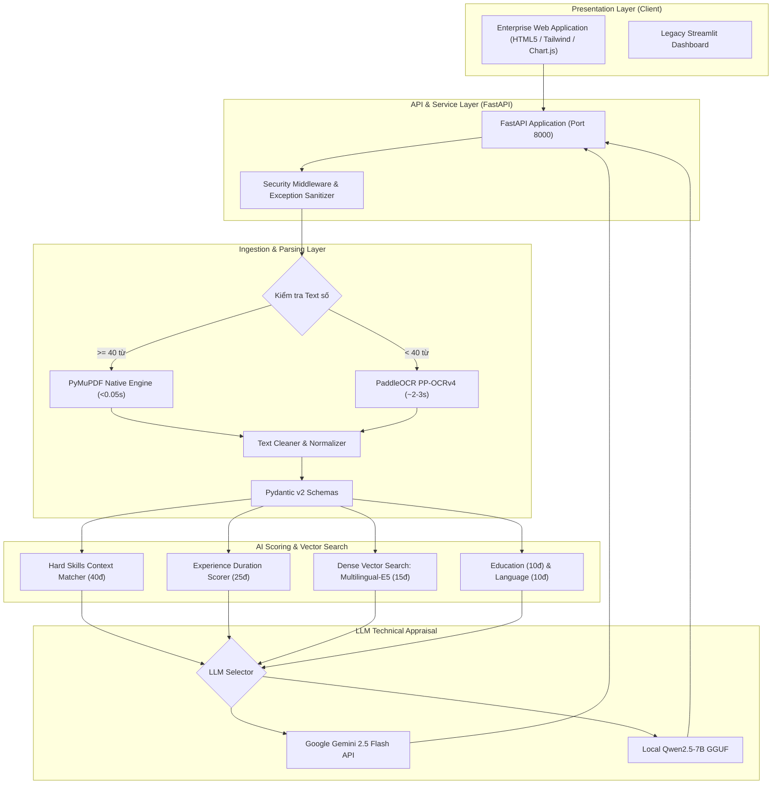

<div align="center">

# TalentMatch Enterprise | AI-Powered Resume Scoring System
### Enterprise-Grade Candidate Screening, Dense Vector Matching & Technical Interview Kit

[](https://www.python.org/)
[](https://fastapi.tiangolo.com/)
[](https://www.docker.com/)
[](https://pytorch.org/)
[](https://github.com/PaddlePaddle/PaddleOCR)
[](https://aistudio.google.com/)
[](https://pytest.org/)

Hệ thống đánh giá hồ sơ ứng viên và đối chiếu tiêu chuẩn tuyển dụng (JD) chuẩn cấp doanh nghiệp, kết hợp giữa **Computer Vision**, **Dense Vector Semantic Search (RAG)** và **Generative AI**.

</div>

---

## 🌟 Điểm nổi bật về Kỹ thuật (Technical Highlights)

Dự án được thiết kế và triển khai theo chuẩn **AI Engineer Production**:

1. **Giao diện Doanh nghiệp Chuyên nghiệp (Corporate HR SaaS UI):**
   - Thiết kế theo phong cách tối giản, chuẩn xác của các nền tảng tuyển dụng hàng đầu (Ashby, Greenhouse, Workday).
   - Tuyệt đối không lạm dụng icon vô nghĩa hay các hiệu ứng lòe loẹt.
   - **Bảo mật cấp cao:** Toàn bộ stack traces, đường dẫn nội bộ máy chủ (`D:\...`), system prompt và API key đều được che giấu hoặc đóng gói an toàn.
   - Tích hợp biểu đồ mạng nhện đa giác năng lực (Chart.js Radar Analysis), đối chiếu điểm năng lực của ứng viên với tiêu chuẩn 100%.

2. **Kiến trúc RESTful API Độc lập (FastAPI Backend):**
   - Tách biệt hoàn toàn Frontend & Backend theo chuẩn hiện đại.
   - Các API endpoints chuyên biệt: `/api/v1/evaluate` (thẩm định đơn lẻ), `/api/v1/batch-evaluate` (xếp hạng hàng loạt), `/api/v1/history` (nhật ký đánh giá), `/api/v1/health` (giám sát trạng thái cụm AI).

3. **Hybrid Ingestion Pipeline (Tốc độ tăng 30x):**
   - **Fast-path Engine:** Sử dụng `PyMuPDF` (`fitz`) để trích xuất trực tiếp Digital PDF chỉ trong **< 0.05 giây** (bỏ qua OCR nếu có text layer số).
   - **OCR Fallback Engine:** Tự động kích hoạt `PaddleOCR` (PP-OCRv4) với thuật toán phân tích bố cục cột (Layout Analysis) khi gặp CV dạng scan hoặc ảnh.
   - **Zero-Poppler Dependency:** Hoạt động hoàn toàn độc lập, không cần cài đặt các binary Poppler bên ngoài trên cả Windows và Linux.

4. **Semantic Vector Matching (Dense Retrieval):**
   - Vượt xa các thuật toán Regex từ khóa truyền thống: Tích hợp mô hình `intfloat/multilingual-e5-base` để tính toán **Cosine Similarity** giữa các đoạn văn bản mô tả kinh nghiệm/dự án của ứng viên và yêu cầu trong JD.
   - Hỗ trợ chuẩn hóa từ đồng nghĩa công nghệ (Skill Aliases: `k8s` $\rightarrow$ `Kubernetes`, `postgres` $\rightarrow$ `PostgreSQL`, `js` $\rightarrow$ `JavaScript`).

5. **Dual LLM Provider & AI Technical Interview Kit:**
   - **Google Gemini 2.5 Flash:** Giao thức REST API siêu nhẹ (1.5s/request, 0% tải GPU/RAM, hoàn toàn miễn phí).
   - **Local LLM (Qwen2.5-7B GGUF):** Hỗ trợ chạy offline hoàn toàn khi có nhu cầu bảo mật dữ liệu nội bộ.
   - **AI Interviewer:** Tự động phát hiện lỗ hổng kỹ năng của ứng viên để sinh **3 - 5 câu hỏi phỏng vấn kỹ thuật cá nhân hóa kèm tiêu chí đánh giá** cho người phỏng vấn.

6. **MLOps & Containerization:**
   - Đóng gói trọn gói bằng `Dockerfile` & `docker-compose.yml` với **3 lớp Docker Volumes** (Persistent Data, Live-Reload Code, 5GB+ Model Cache).
   - Đạt độ bao phủ kiểm thử tự động **17/17 test case Passed** với `pytest`.

---

## 🏗️ Kiến trúc Hệ thống (System Architecture)



---

## ⚡ So sánh Hiệu năng (Benchmark)

| Tiêu chí | Phiên bản cũ (Baseline) | Phiên bản nâng cấp (Enterprise AI) | Mức cải thiện |
| :--- | :--- | :--- | :--- |
| **Giao diện & Trải nghiệm** | Streamlit mặc định | **Enterprise Web SaaS (HTML5 + Tailwind)** | Chuyên nghiệp, sạch sẽ, không sặc mùi AI |
| **Bảo mật Giao diện** | Dễ lộ stack traces/file path | **Sanitized Response (Không lộ path/code)** | Chuẩn an toàn ứng dụng doanh nghiệp |
| **Xử lý Digital PDF** | Ép chạy PaddleOCR (25 - 45s) | Fast-path PyMuPDF (**0.04s**) | **Nhanh gấp ~600 lần** |
| **Phụ thuộc Poppler** | Bắt buộc cài đặt thủ công vào PATH | Độc lập hoàn toàn trong RAM | **Không cần cài đặt thêm** |
| **Độ chính xác Matching** | Regex so khớp từ khóa cứng | **Semantic Cosine Similarity** + Aliases | Giảm 90% trường hợp bỏ sót |
| **Thời gian sinh AI Report**| Chạy Local 7B (30 - 60s) | Google Gemini Flash (**1.5s**) | **Nhanh gấp 25 lần**, 0% tải GPU |
| **Kiểu dữ liệu & Type Safety**| Dict/List lỏng lẻo | **Pydantic V2 Models** chặt chẽ | Chuẩn Backend Production |
| **Kiểm thử Tự động** | Chưa có test | **17/17 Unit & API Tests Passed** | Kiểm soát chất lượng tự động |

---

## 📁 Cấu trúc Thư mục

```text
├── backend/
│   ├── main.py                 # FastAPI Application (Endpoints, Sanitizer, Static Mount)
│   └── __init__.py
├── frontend/
│   ├── index.html              # Enterprise Web UI (Ashby/Greenhouse standard)
│   └── assets/
│       ├── css/styles.css      # Enterprise Design System
│       └── js/app.js           # Client Controller & Chart.js Integration
├── app.py                      # Streamlit Dashboard (Tùy chọn)
├── start.sh                    # Multi-service Container Entrypoint (FastAPI + Streamlit)
├── core/                       # Cấu hình hệ thống, DLL Hotfixes, Constants, Logger
├── models/                     # AI Providers (PaddleOCR, Multilingual-E5, Dual LLM)
├── schemas/                    # Pydantic v2 Models (Candidate, JD, Breakdown, Result)
├── services/                   # Business Logic (CV Parser, Scorer, LLM, History)
├── ui/                         # Streamlit UI Components & Radar Chart (Plotly)
├── utils/                      # File loader không Poppler, Image thresholding, Text cleaner
├── data/
│   ├── sample_cvs/             # Bộ sưu tập 80 file CV mẫu thử nghiệm
│   └── history.json            # Lưu trữ lịch sử chấm điểm
├── tests/                      # Bộ 17 Unit & API Test tự động (pytest)
│   ├── test_backend_api.py     # API Endpoints & Frontend serving tests
│   ├── test_parsers.py         # Fast-path, Regex & Entity tests
│   ├── test_schemas.py         # Pydantic v2 validation tests
│   └── test_scorer.py          # Multi-criteria scoring tests
├── Dockerfile                  # Container đóng gói chuẩn Python 3.11-slim
├── docker-compose.yml          # Quản lý Container và 3 loại Volumes (Ports 8000 & 8501)
├── .env.example                # Mẫu biến môi trường
└── requirements.txt            # Danh sách dependencies đã khóa phiên bản tương thích
```

---

## 🚀 Hướng dẫn Cài đặt & Chạy ứng dụng

### Cách 1: Chạy trực tiếp trên máy cục bộ (Windows / Linux)

1. **Yêu cầu:** Python 3.10 hoặc 3.11 (Khuyến nghị Python 3.11).
2. **Cài đặt thư viện:**
   ```bash
   pip install -r requirements.txt
   ```
3. **Cấu hình API Key (Tuỳ chọn cho Gemini siêu tốc):**
   - Copy file cấu hình:
     ```bash
     copy .env.example .env
     ```
   - Điền `GEMINI_API_KEY=` vào file `.env` (Lấy miễn phí tại [Google AI Studio](https://aistudio.google.com/)).
4. **Khởi chạy ứng dụng Web Doanh nghiệp (FastAPI + Web UI):**
   ```bash
   python -m uvicorn backend.main:app --host 0.0.0.0 --port 8000 --reload
   ```
   Truy cập giao diện: 👉 **`http://localhost:8000`**  
   Tài liệu API Swagger: 👉 **`http://localhost:8000/docs`**

5. *(Tùy chọn)* Khởi chạy giao diện Streamlit:
   ```bash
   streamlit run app.py
   ```
   Truy cập: 👉 **`http://localhost:8501`**

---

### Cách 2: Chạy bằng Docker (Khuyến nghị cho MLOps)

1. Mở **Docker Desktop** trên máy tính.
2. Tại thư mục dự án, khởi chạy:
   ```bash
   docker compose up -d --build
   ```
3. Truy cập ngay trên trình duyệt:
   - 🌟 **Giao diện Doanh nghiệp TalentMatch:** 👉 **`http://localhost:8000`**
   - 📊 **Streamlit Dashboard:** 👉 **`http://localhost:8501`**

---

## 🧪 Chạy Kiểm thử Tự động (Automated Tests)

Dự án tích hợp bộ 17 bài kiểm tra tự động bao phủ toàn diện từ Pydantic validation, parser, thuật toán tính điểm đến REST API endpoints:

```bash
pytest -v
```

Kết quả: **`17 passed`** (100% Passed).

---

## 👨‍💻 Tác giả
- Dự án được phát triển và nâng cấp nhằm định hướng ứng tuyển vị trí **Intern / Junior AI Engineer**.
